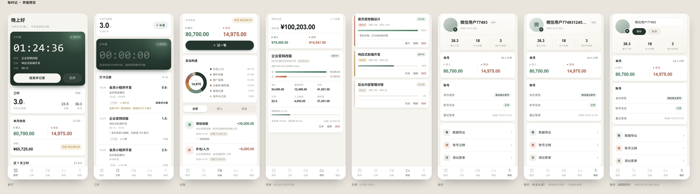

# 账时记 BookkeepingWhiz

一个给**自由职业者 / 接活的人**用的「工时打卡 + 项目收支记账」工具：
微信小程序 + Java 后台，数据存在自己账号下，随时可导出备份。



## 为什么做它

接活的人常遇到的四件麻烦事：

- 甲方问「这个做了多久」，翻聊天记录翻到眼花
- 报价全凭感觉，做完发现根本不赚钱
- 收款全靠催，哪笔结了哪笔没结记不清
- 月底一对账，支出比收入还算得清

账时记把这四件事放到同一条流水线上：**计时 → 记账 → 算盈亏 → 出结算单**。

## 功能特性

- **工时打卡**：一键计时 / 手动补录 / 作废，计费状态可标记，按日周月统计
- **收支记账**：收入、支出按类别记录，支付凭证截图留档，应收款跟踪
- **项目管理**：项目、任务、进度与预算；收入 − 成本 = 净利润，工时 × 时薪自动核算
- **数据看板**：近 7 天工时趋势、支出构成环形图、项目盈亏条形图
- **数据导出**：Excel（可直接发给甲方对账）/ JSON 全量备份
- **账号**：微信一键登录；支持账号注销（REQ 级别的注销前检查：进行中计时阻断、应收款强提醒）

## 技术栈

| 端 | 技术 |
|---|---|
| 后台 `server/` | RuoYi 4.x（Spring Boot 4.1 / JDK 17 / MyBatis）、MySQL 8、Redis |
| 小程序 `miniprogram/` | 微信原生（无第三方 UI 库），Canvas 2d 图表，纯 WXSS 设计系统 |

## 目录结构

```
bookkeeping-whiz/
├── server/                 # Java 后台（RuoYi 多模块）
│   ├── ruoyi-admin/        # 启动模块与配置（配置模板为 *.yml.example）
│   ├── ruoyi-biz/          # 业务模块：工时 / 项目 / 记账 / 微信登录
│   ├── ruoyi-system/       # 系统模块（用户、角色、菜单）
│   └── sql/                # 建表 SQL（RuoYi 基础表 + 业务表）
├── miniprogram/            # 微信小程序前端
│   ├── pages/              # 首页 / 工时 / 记账 / 项目 / 任务 / 我的
│   ├── components/         # 计时卡片、折线图组件
│   └── utils/              # 请求封装、登录态（配置模板为 config.example.js）
└── docs/                   # 工具脚本、界面预览、部署与接口文档
```

## 快速开始

### 0. 环境要求

- JDK 17+、Maven 3.8+
- MySQL 8.x、Redis
- 微信开发者工具（开发小程序端）

### 1. 初始化数据库

创建数据库 `book_keep`（utf8mb4），依次导入：

```bash
server/sql/ry_20260417.sql     # RuoYi 基础表
server/sql/quartz.sql          # 定时任务表
server/sql/book_keep_biz.sql   # 业务表（工时/项目/任务/记账/微信用户）
```

### 2. 启动后台

配置文件只提供模板（避免把任何人的密码传上 GitHub），复制并填入你自己的：

```bash
cd server/ruoyi-admin/src/main/resources
cp application-dev.yml.example application-dev.yml
# 编辑 application-dev.yml：数据库密码、Druid 控制台密码、token.secret（至少 32 位随机串）
```

然后运行 `ruoyi-admin` 模块的 `RuoYiApplication`（或 `mvn spring-boot:run`），默认端口 `9066`。

> 💡 本地调试模式：`wx.miniapp.appid` 留空时，后端不校验微信 code，直接派生伪 openid，
> 不需要小程序后台任何配置即可把流程跑通。

### 3. 启动小程序

1. 微信开发者工具导入 `miniprogram/` 目录，AppID 换成你自己的（当前是测试号 `touristappid`）
2. 复制配置并填入你的域名：

```bash
cd miniprogram/utils
cp config.example.js config.js
# 编辑 config.js：prod 域名改成你自己的
```

3. 编译预览。管理后台默认账号 `admin / admin123`（导入 RuoYi 基础 SQL 后的默认密码，登录后请立即修改）

### 4. （可选）灌演示数据

想直接看图表效果，可以先在小程序里登录一次，再执行：

```bash
export DB_PASSWORD=你的数据库密码
python docs/seed-demo-data.py
```

### 5. （可选）接口冒烟测试

```bash
./docs/api-smoke-test.sh                              # 默认打本地 9066
API_BASE=https://your-domain.com ./docs/api-smoke-test.sh   # 打线上
```

## 部署上线

参考 `docs/install-server.sh`（一键安装 MySQL/Redis/Nginx 的服务器脚本）和
`docs/nginx-example.conf`（Nginx 反代示例：80/443 → 127.0.0.1:9066）。

微信侧需要：

1. 公众平台「开发设置」配置 request / uploadFile / downloadFile 合法域名
2. 「用户隐私保护指引」声明：收集昵称头像（头像昵称填写能力）、相册选图（上传凭证）
3. 小程序备案 + 类目（工具类）

## 设计说明

- 小程序端有一套完整的「纸感账本」设计系统：暖纸白底 + 深松绿主色 + 降饱和语义色，
  层级靠留白和发丝线，不用大色块；所有颜色 token 定义在 `app.wxss` 的 `page{}`
- 图表不依赖第三方库：折线图用 Canvas 2d 贝塞尔平滑绘制，支出构成用纯 WXSS conic-gradient
- 更多细节见 `docs/业务代码说明与需求扩展.md`、`docs/requirements.md`

## License

[MIT](LICENSE) — 基于 [RuoYi-Vue](https://gitee.com/y_project/RuoYi-Vue)（MIT）构建，感谢若依开源社区。

## 安全提示

- 仓库内所有配置均为 `.example` 模板，真实配置已被 `.gitignore` 排除，**不要**把填好密码的配置文件提交上来
- 上线前务必：更换默认后台密码、`token.secret` 用强随机值、数据库与 Redis 设置独立强密码
